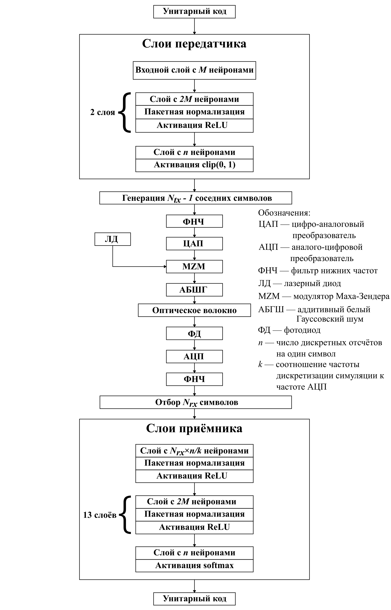

TF-OFCS
=======

В данном репозитории содержится исходный код для магистерской диссертации на
тему «Исследование возможности применения автокодировщиков для оптимизации
волоконно-оптических систем передачи». В работе была разработана и исследована
архитектура оптического трансивера на основе нейронных сетей
(автокодировщиков). Весь смысл в замещении большей часть цифровой обработки
сигнала нейронной сетью с обучением под моделируемый канал связи. Это касается
одновременно передатчика и приёмника - они обучаются совместно как одна
целостная нейронная сеть. Всё сделано на Python с помощью TensorFlow.

Репозиторий содержит следующее:
1) Дифференцируемые компоненты для моделирования активных и пассивных
 компонентов ВОСП (волоконно-оптических систем передачи).
2) Реализации самих нейронных сетей, обучение и инференс.
3) Инструменты командной строки для обучения, тестирования и оптимизации моделей.
4) Средства для визуализации данных.
5) Профили моделей, которые использовались для исследования.

Модель трансивера включает в себя не только обычные слои нейронной сети, но и
дифференцируемые компоненты, моделирующие поведение активных и пассивных
компонентов системы передачи, таких как лазерный диод, АЦП/ЦАП, модулятор
Маха-Цендера, фотодиод, оптическое волокно, и множество других. Во время
обучения производится моделирование распространения сигнала по заданному каналу
связи, включая различные искажения, шум и потери. Это позволяет оптимизировать
модель под заданный канал или некоторое множество каналов связи с любыми
свойствами, в том числе под сильно варьирующиеся условия.

В процессе обучения, модель автоматически «учится» формировать оптический
сигнал на стороне передатчика и декодировать их на стороне приёмника,
минимизируя искажения данных на выходе (данные на выходе должны
максимально совпадать с данными на входе). Таким образом, передатчик учится
формировать оптимальный сигнал для заданного канала, а приёмник — учится
максимально точно извлекать полезную нагрузку из искажённого сигнала.

## Архитектура трансивера

На рисунке ниже показана структурная схема одного из исследованных трансиверов.

## Кратко о результатах

Были разработаны и исследованы две системы (IM/DD и IQ) в различных
конфигурациях, оценивались дальность связи при скорости передачи 42 Гбит/с,
коэффициент битовых ошибок (BER). Конечно, применение подобных архитектур сомнительно
в сегодняшних условиях, в конце-концов есть другие более благоприятные
направления совершенствования современных систем связи. Тем не менее, здесь
есть несколько интересных свойств, нетипичных для «традиционных» систем передачи:
1) Возможность автоматической оптимизации под специфичные условия
 распространения сигнала и другие компоненты системы во время обучения.
2) Устойчивость к сильно варьирующимся условиям без предварительной калибровки.
 Обычно, системам передачи сначала необходимо оценить свойства канала. Нейронная сеть
 же успешно научилась извлекать эту информацию на лету, ещё и с устойчивостью к резким
 изменениям.
3) Подобный подход применим не только для оптики, но и например, для мобильной
 связи. Впрочем, он может быть адаптирован и под другие задачи, везде где есть
 что-то похожее на передатчик, канал связи и приёмник.
